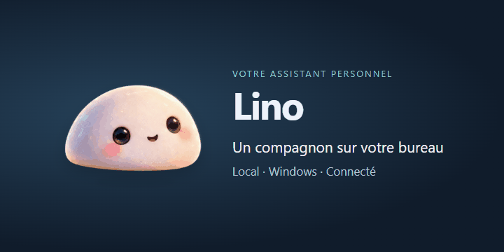
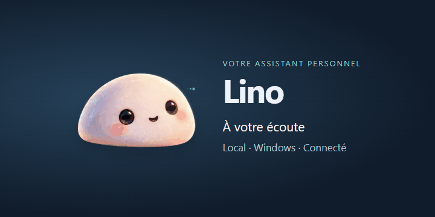

# Lino

**Un assistant personnel pour Windows, avec une mascotte animée en haut de votre écran.**

Lino associe une interface de bureau discrète, un moteur conversationnel via Ollama,
la dictée vocale et des outils pour retrouver des documents, consulter vos services
connectés et suivre les demandes de validation de vos agents.



Version **0.2.4**. Le dépôt contient l’application desktop, le moteur Python
et le compagnon Android.

## Ce que fait Lino

| Fonction | Comportement implémenté |
| --- | --- |
| Conversation | Répond en français et enchaîne des appels d'outils avec un modèle Ollama. Affiche la demande, la réponse et les actions. |
| Encoche de bureau | Fenêtre Tauri transparente, au premier plan, centrée au bord supérieur de l'écran. Un clic ouvre l'interface ; `Échap` la réduit. |
| Mascotte | Respiration, clignements, suivi du pointeur et réaction au survol/clic ; états d'écoute, réflexion, recherche, parole et erreur. |
| Dictée | Transcription avec faster-whisper après décodage PyAV. Le composeur permet de dicter puis d'envoyer sa demande. |
| Voix | Edge TTS en ligne, puis voix Windows SAPI en secours. Possibilité de couper ou d'arrêter la voix. |
| Web | Recherche automatique sans clé, ou Brave Search avec votre clé. Affiche les sources utilisées. |
| Fichiers | Recherche par nom dans les dossiers Windows, OneDrive et les dossiers ajoutés. Ouverture de fichiers et lecture des PDF texte avec repères de page. |
| Gmail | Recherche et lecture, récupération de pièces jointes, brouillons et envoi après validation. Les demandes de messagerie sont dirigées vers Gmail. |
| Google Docs | Recherche et lecture, y compris paragraphes et tableaux des onglets pris en charge. |
| Notion / MCP | Connexion OAuth aux serveurs compatibles, découverte des outils et validation des actions d'écriture. |
| Stripe | Surveillance de `payment_intent.succeeded`, alertes, dédoublonnage et reprise du curseur. |
| Agents desktop | Détection des demandes de validation Codex/Claude sur Windows ; autoriser/refuser lorsque les contrôles sont accessibles et identifiés. |
| Android | Enregistrement vocal transmis au PC et commandes vocales de réveil de Lino. |



Ces GIF illustrent les animations CSS de la mascotte du projet, sans conversation
réelle ni données de comptes connectés.

## Exemples de demandes

- « Cherche ma facture électricité dans mon PC. »
- « Lis ce PDF et donne-moi le total avec la page. »
- « Retrouve le CV joint au mail de cette personne. »
- « Prépare un brouillon pour client@example.com. »
- « Cherche mon document de réunion dans Google Docs. »
- « Crée une tâche dans ma base Notion. »
- « Quels paiements Stripe as-tu détectés ? »

Les services concernés doivent être connectés. La qualité de l'interprétation et
des appels d'outils dépend du modèle choisi.

## Architecture

```text
Interface React + TypeScript + Vite
                │
           Tauri 2 / Rust ─── Relais Windows des validations
                │
         Lino Core / FastAPI ←── Compagnon Android
                │
     ┌──────────┼─────────────┐
   Ollama   Voix / Whisper   Outils locaux, Google, Stripe, MCP
```

| Dossier | Rôle |
| --- | --- |
| `src/` | Interface, styles, composeur, connexions et mascotte. |
| `src-tauri/` | Fenêtre native, démarrage du Core et relais desktop. |
| `core/` | API FastAPI, configuration et état. |
| `core/services/` | Agent, voix, transcription, MCP, notifications, Stripe. |
| `core/tools/` | Gmail, Google Docs, Web, fichiers et PDF. |
| `core/tests/` | Tests avec données et services simulés. |
| `integrations/desktop/` | Accès aux contrôles Windows. |
| `integrations/codex/` | Hooks de notification facultatifs. |
| `mobile/` | Compagnon Kotlin / Jetpack Compose. |
| `docs/media/` | GIF du README. |

## Prérequis Windows

- Python **3.12** recommandé, accessible avec `python`.
- Node.js **22.12 ou plus récent** et npm.
- Rust/Cargo avec la chaîne Windows MSVC, outils C++ et SDK Windows nécessaires à Tauri.
- Microsoft Edge WebView2 Runtime.
- Ollama installé et lancé, avec un modèle téléchargé.
- Internet pour installer les dépendances et télécharger les modèles manquants.

Le projet peut être placé dans le dossier de votre choix ; aucun lecteur particulier n'est requis.

## Démarrage rapide

Ouvrez PowerShell à la racine du projet extrait ou cloné :

```powershell
Copy-Item .\core\.env.example .\core\.env
ollama pull qwen3:4b
.\start-lino.ps1
```

Si PowerShell bloque le script, après en avoir vérifié le contenu :

```powershell
powershell -ExecutionPolicy Bypass -File .\start-lino.ps1
```

Le script crée `core/.venv`, installe les dépendances Python, prépare les dépendances
JavaScript puis lance Tauri en développement. La fenêtre native démarre le Core
si aucun service n'écoute déjà sur le port 8765. Le premier usage de Whisper peut
télécharger un modèle et prendre plus de temps.

### Installation manuelle

```powershell
python -m venv core/.venv
.\core\.venv\Scripts\python.exe -m pip install -r core/requirements.txt
npm ci
npm run tauri dev
```

### Compilation

```powershell
npm run build        # TypeScript et interface Vite
npm run tauri build  # Application native, prérequis Rust/C++ nécessaires
```

L'exécutable cherche le dossier `core` près du projet et utilise son environnement
Python. **La distribution ne fournit pas un installateur entièrement autonome** :
déplacer uniquement l'exécutable ne suffit pas. Gardez le projet et `core/.venv` accessibles.

Pour travailler sur l'interface dans un navigateur, lancez le Core dans un terminal
et Vite dans un second terminal, depuis la racine :

```powershell
.\core\.venv\Scripts\python.exe core/main.py
# Second terminal :
npm run dev
```

Vite utilise le port 1420. Les fonctions natives de fenêtre et de relais desktop
nécessitent Tauri ; elles ne sont pas disponibles dans un simple navigateur.

## Configuration

Les paramètres se définissent dans `core/.env`, à partir de l'exemple sans secrets.

| Variable | Valeur par défaut / usage |
| --- | --- |
| `LINO_HOST` | `127.0.0.1`, Core accessible seulement depuis le PC. |
| `LINO_PORT` | `8765` ; ne pas changer sans adapter aussi les clients et le relais. |
| `LINO_MODEL` | `qwen3:4b`, à télécharger dans Ollama. |
| `OLLAMA_HOST` | `http://127.0.0.1:11434`. |
| `WHISPER_MODEL` | `small`. |
| `WHISPER_DEVICE` / `WHISPER_COMPUTE_TYPE` | `cpu` / `int8`. |
| `TTS_ENABLED` / `TTS_RATE` / `TTS_VOICE_HINT` | `true` / `185` / `fr`. |
| `BRAVE_SEARCH_API_KEY` | Facultatif ; vide = recherche automatique. |
| `WEB_SEARCH_COUNTRY` / `WEB_SEARCH_LANG` | `FR` / `fr`. |
| `WEB_RESULTS` | `8`. |
| `DOWNLOAD_DIR` | Par défaut, `Downloads/Lino` dans le dossier utilisateur. |
| `N8N_WEBHOOK_BASE_URL` | Facultatif ; connexion configurable, sans agent n8n complet promis. |
| `GMAIL_CREDENTIALS_PATH` | `google_credentials.json`, relatif au dossier `core`. |
| `GMAIL_TOKEN_PATH` | `google_token.json`, compatibilité avec l'ancien stockage. |

## Connecter vos services

### Google : Gmail et Google Docs

Utilisez votre propre projet Google, les API nécessaires activées, un consentement
OAuth adapté et un client OAuth de type **application de bureau**. Placez son fichier
JSON dans `core/google_credentials.json`, puis connectez Gmail/Google Docs dans
l'interface. Ce fichier est ignoré par Git ; aucun client partagé n'est embarqué.

Gmail demande lecture et composition. Un ancien jeton limité à la lecture doit être
reconnecté pour les brouillons/envois. Google Docs demande la lecture Docs/Drive.

### Notion et MCP

Dans **Connexions**, ajoutez Notion ou un serveur compatible puis terminez l'autorisation
dans votre navigateur. Le client utilise OAuth avec PKCE et le retour local
`http://127.0.0.1:8766/oauth/callback`. Les droits dépendent du compte et du serveur.
Les écritures proposées demandent validation dans Lino.

### Stripe

Ajoutez votre propre clé restreinte autorisant la lecture des événements. Le suivi
consulte les événements environ toutes les 30 secondes tant que le moteur tourne.
La première connexion surveille les nouveaux paiements ; les suivantes reprennent
le curseur sauvegardé. L'interface garde les 50 dernières alertes et distingue le mode test.
Ce suivi ne couvre pas tous les types de paiement ni automatiquement tous les comptes Connect.

### Fichiers locaux

Ajoutez vos dossiers dans **Connexions → Fichiers du PC**. La recherche porte sur les
noms et emplacements ; la lecture PDF extrait ensuite le texte. Les PDF scannés
sans couche texte nécessitent un OCR, non fourni.

### Notifications des agents

Le relais desktop reconnaît les demandes explicites dans les applications prises
en charge. Les demandes ambiguës ou disparues sont refusées. Les boutons accessibles
dépendent de la version de l'application et de l'accessibilité Windows.

Installation facultative des hooks, depuis la racine :

```powershell
.\core\.venv\Scripts\python.exe integrations/codex/install_hook.py
```

L'installateur configure les hooks nécessaires sur la machine locale. Les hooks
notifient les événements ; ils n'accordent pas automatiquement les autorisations.

## Compagnon Android

Ouvrez `mobile/` dans Android Studio et installez le SDK demandé : `compileSdk` et
`targetSdk` 37, Android minimum 24. Le projet inclut le wrapper Gradle nécessaire à la compilation.

L'URL par défaut `http://10.0.2.2:8765` correspond au PC hôte depuis l'émulateur Android.
Pour un téléphone physique, fournissez l'adresse réseau du PC :

```powershell
cd mobile
.\gradlew.bat assembleDebug -PlinoCoreUrl=http://ADRESSE_DU_PC:8765
```

Remplacez `ADRESSE_DU_PC` par l'adresse réelle. `linoCoreUrl` peut également être défini
dans votre configuration Gradle personnelle. Aucune IP personnelle n'est embarquée.

Sur le PC, définissez `LINO_HOST=0.0.0.0` dans `core/.env`, redémarrez le Core et
autorisez le port uniquement sur un réseau privé de confiance. L'API ne possède
pas d'authentification globale : **ne l'exposez pas sur Internet et ne redirigez pas
ce port sur votre routeur**. Android utilise actuellement HTTP. L'application demande
l'autorisation microphone et transmet un enregistrement temporaire au PC.

## Données et confidentialité

- Ollama exécute le modèle de conversation ; les services connectés et le Web
  communiquent avec leurs fournisseurs. Edge TTS transmet le texte à un service en ligne.
  Lino n'est donc pas intégralement hors ligne.
- La configuration personnelle est stockée dans `%LOCALAPPDATA%/Lino` sous Windows.
  Certains paramètres et identifiants de client sont enregistrés dans `config.json`.
- MCP, Stripe et Google Docs utilisent Windows DPAPI. Gmail comporte aussi du stockage
  JSON. Ne publiez jamais le dossier des données utilisateur.
- Journaux, téléchargements, événements d'approbation et sauvegardes ne sont pas des sources publiques.
- `.gitignore` exclut les fichiers sensibles courants, mais n'efface pas un secret
  déjà commité. Toute clé exposée doit être révoquée et remplacée chez son fournisseur.

## Dépannage

| Symptôme | À vérifier |
| --- | --- |
| Le modèle ne répond pas | Ollama lancé, modèle téléchargé, nom identique à `LINO_MODEL`. |
| Interface en attente | Dépendances Python, port 8765, endpoint `/health`. |
| Compilation Tauri impossible | Rust MSVC, outils C++ Windows, WebView2, dépendances npm. |
| Google non configuré | Client OAuth local, API activées, compte autorisé au consentement. |
| Téléphone déconnecté | URL du PC, même réseau, pare-feu, `LINO_HOST`. |
| Échec DPAPI | Session Windows avec profil disponible ; ne pas transférer les fichiers chiffrés d'un autre compte. |
| PDF vide | Document probablement scanné ; ajouter une couche texte par OCR hors de Lino. |

## Contributions et médias

Décrivez le comportement attendu et les vérifications effectuées dans vos contributions.
Conservez les tests utiles et n'ajoutez aucun identifiant de compte. Les sources des
icônes figurent dans [`src/assets/services/SOURCES.md`](src/assets/services/SOURCES.md).
